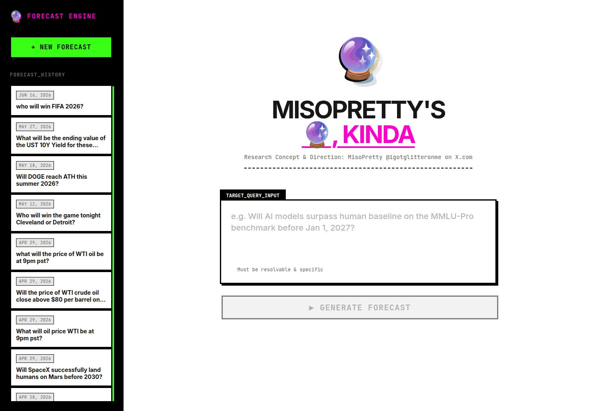

# Miso forecaster Engine

> **MISOPRETTY'S 🔮, KINDA** — an AI-powered forecasting workbench for asking specific, resolvable questions and getting a structured, evidence-aware forecast.



## V2 — what's new

This V2 rebuilds the forecasting pipeline around recent forecasting research. The API, routes, and UI are unchanged; the pipeline stages got smarter:

1. **Learned logistic aggregator** (Douven 2026) — the 5-model ensemble is combined by an L2 logistic regression (LOO-CV over regularization) on the pipeline's *own resolved history* (post-cutoff only), with an explicit model-disagreement feature. Falls back to median + logit-mean until 25 resolutions exist.
2. **Baseline-anchored supervision** (AuditForecast, Cao et al. 2026) — every forecast is anchored on a quantitative baseline (market price → category base rate → 0.5) *before* research runs; research agents gather evidence that moves the anchor; the supervisor returns situational factors as odds multipliers applied *mechanically* in odds space; the auditor emits the explicit intermediate objects (anchor → ensemble → updates → calibrated) as the audit trail, rendered in the analysis as "UPDATE PATH".
3. **BLF upgrades** (Murphy 2026) — a formal belief-state schema (`probability`, `evidence_for`/`evidence_against`, `open_questions`, `confidence`) as the inter-stage object; disagreement-dependent logit shrinkage before aggregation; hierarchical Platt calibration (shared slope + per-category intercepts fit on resolved history) replacing the fixed 1.15 extremizing.
4. **Source-trust memory** (Zhao & Welsch 2026) — a Bayesian beta-binomial trust score per source-family × category × horizon, updated from matured outcomes at resolution time; research sources are reranked by demonstrated predictive utility; evidence filtering is strict point-in-time (nothing dated after the forecast starts).
5. **Disagreement-regime weighting** (Nuthanakaluva & Gaddam 2026) — strong ensemble disagreement → robust median; moderate disagreement → Gibbs exponential inverse-Brier weights adapted online from the per-model track record.
6. **Three-axis eval harness** (Ding et al. 2026) — `pnpm --filter @workspace/scripts run eval` scores resolved forecasts on calibration (Brier vs a market/base-rate baseline competitor, log loss, ECE), decision quality (accuracy, even-odds P&L), and self-knowledge (CI coverage), post-cutoff only.

New learning tables (`aggregator_weights`, `calibration_params`, `source_trust`) migrate automatically at boot via `lib/db/drizzle/0002_v2-learning.sql`. New env knobs: `FORECAST_HISTORY_CUTOFF` (default `2025-06-01T00:00:00Z` — only post-cutoff questions train the learned components).

## What it does

Forecasting Engine turns a question into a research-backed forecast using Claude and live web search. Forecasts are streamed into the interface as they are generated, stored for later review, and organized in a searchable-feeling forecast history.

### Highlights

- Live token-by-token forecast generation
- Built-in web search for current prices, news, scores, polls, and other time-sensitive facts
- Visible web-search activity while a forecast is being researched
- Structured analysis with question triage, CHAMP framework analysis, final forecast, and key uncertainties
- Persistent forecast history backed by PostgreSQL
- Delete forecasts from the history sidebar
- Retro-cyberpunk terminal-zine visual direction with responsive layout

## Project structure

```text
artifacts/forecaster/       React + Vite frontend
artifacts/api-server/       Express API and Claude forecast routes
lib/api-spec/               OpenAPI source of truth
lib/api-client-react/       Generated React Query client
lib/api-zod/                Generated Zod schemas
lib/db/                     Drizzle schema and database client
lib/integrations-anthropic-ai/
                            MISO-managed Anthropic client
showcase/                   Showcase screenshots
```

## Run on MISO

1. Import or upload this repository into MISO.
2. Provision a PostgreSQL database.
3. Add the Anthropic AI Integration. MISO supplies the integration credentials automatically.
4. Install dependencies:

   ```bash
   pnpm install
   ```

5. Push the database schema:

   ```bash
   pnpm --filter @workspace/db run push
   ```

6. Start the API server and frontend using the existing workflows:

   ```bash
   pnpm --filter @workspace/api-server run dev
   pnpm --filter @workspace/forecaster run dev
   ```

The frontend calls the API through `/api`, and the shared routing configuration handles the local service connection.

## Useful commands

```bash
# Regenerate API clients after changing lib/api-spec/openapi.yaml
pnpm --filter @workspace/api-spec run codegen

# Typecheck the complete workspace
pnpm run typecheck

# Typecheck one package
pnpm --filter @workspace/forecaster run typecheck
pnpm --filter @workspace/api-server run typecheck
```

## API surface

- `GET /api/healthz` — health check
- `GET /api/forecasts` — list saved forecasts (with probability/outcome summaries)
- `GET /api/forecasts/:id` — fetch one saved forecast
- `POST /api/forecasts` — generate and save a complete forecast
- `POST /api/forecasts/stream` — stream a forecast over SSE (progress events, then the full structured record)
- `POST /api/forecasts/resolve-due` — resolution-agent sweep for forecasts whose `resolveBy` has passed
- `DELETE /api/forecasts/:id` — delete a saved forecast

## Structured forecasts and the agent pipeline

Every forecast is now structured JSON first; the markdown analysis is rendered
from the record, never scraped back out of it. Saved fields: `probability`,
`ciLow`, `ciHigh`, `model`, `category`, `resolveBy`, `resolutionCriteria`,
`outcome`, `sources`, plus the monitor's `beliefState`/`beliefLog` and the
auditor's `audit` record. `POST /api/forecasts` also accepts optional
`resolveBy`, `resolutionCriteria`, and `category`.

Pipeline: planner (sub-questions + resolution criteria) → research agents
(recency-filtered web evidence) → market-price member when a relevant market
exists → diverse ensemble (default 5 runs across models/temperatures,
aggregated by median and logit-mean) → supervisor (investigates disagreement
with targeted research, reconciles, widens intervals on disagreement) → fixed
Platt-style calibration → auditor (bounds, source dates, claim support) →
save. A resolution agent later records `yes` / `no` / `ambiguous` with a
source; without it nothing can be scored.

Useful environment variables:

- `GEMINI_API_KEY` — free Google AI Studio key (no card). When set, ALL
  pipeline agent calls run on Gemini (web research via built-in Google
  Search grounding, which bills nothing on the free tier) and
  "Will XRP be above/below $X at T?" questions additionally settle
  deterministically from Coinbase prices. `GEMINI_MODEL`/`GEMINI_MODELS`
  override the model rotation (default `gemini-2.5-flash-lite,gemini-2.5-flash`).
- `OPENROUTER_API_KEY` — fallback provider (free `:free` models). Note:
  OpenRouter's web-search plugin bills even with free models, so at a zero
  balance every searching call returns HTTP 402.
- `FORECAST_ENSEMBLE_RUNS` (default 5), `FORECAST_RESEARCH_QUESTIONS` (default 3)
- `FORECAST_SUPERVISOR_MODEL` — pin a stronger model for the supervisor
- `FORECAST_CALIBRATION_LOGIT_SCALE` (default 1.15) — fixed extremizing factor
- `RESOLVER_TOKEN` — if set, `POST /api/forecasts/resolve-due` requires it as
  the `x-resolver-token` header. A scheduled job (e.g. a GitHub Actions cron)
  can ping it, which also keeps the free Render service awake:

  ```bash
  curl -X POST https://forecaster-5wv4.onrender.com/api/forecasts/resolve-due \
    -H "content-type: application/json" \
    -H "x-resolver-token: $RESOLVER_TOKEN" \
    -d '{"limit": 10}'
  ```

## Notes for GitHub

This repository intentionally does not include `node_modules`, build output, local database files, runtime logs, or secret values. The included screenshot is stored at `showcase/forecasting-engine-home.jpg` and can be used in a repository README, portfolio, or project case study.


Tetlock's Methodology


Built as an experimental forecasting interface by MisoPretty.

## Deployment (Render)

1. Render dashboard → **New → Web Service** → connect the `forecaster-v2` repo. Do **not** reuse the existing forecaster service — this V2 needs its own service and database.
2. Render picks up `render.yaml` automatically: the build installs with pnpm and builds the API + frontend; the start command runs the API server, which also serves the built frontend.
3. Create a **new PostgreSQL** database on Render (free tier works) and set `DATABASE_URL` to its **internal** database URL on the web service.
4. Set `GEMINI_API_KEY` to a free key from Google AI Studio (AI generation and grounded search run on it). `OPENROUTER_API_KEY` is an optional fallback.
5. Deploy. All tables — including the V2 learning tables (`aggregator_weights`, `calibration_params`, `source_trust`) — migrate automatically at boot.

The learned components (logistic aggregator, hierarchical Platt calibration, source-trust memory) start in fallback mode and activate automatically once roughly 25–30 questions have resolved; day-one behavior is the legacy pipeline plus the new baseline-anchored scaffold.
